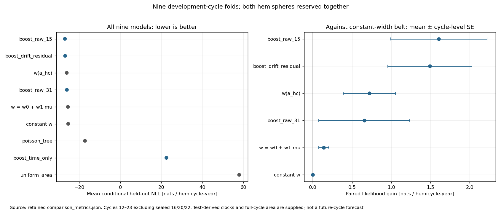
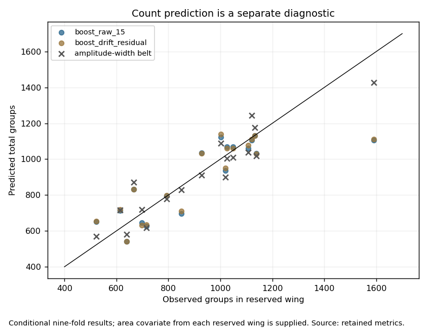
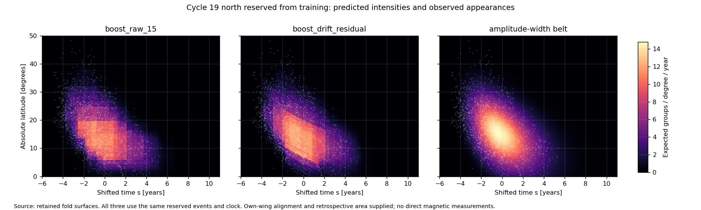

# Homework 3: extended model comparison

## What is currently best?

**The best mean leave-one-cycle-out NLL belongs to `boost_raw_15`, but the top two boosting models are not decisively separated.** Raw-coordinate boosting scores −26.9856 nats per hemicycle-year; physics-aligned boosting scores −26.8704. Their paired difference is −0.1151 with a descriptive nine-cycle SE of 0.1796, so the mean advantage is smaller than one SE. Raw boosting is better in only 8/18 wings and 4/9 cycle averages; the median wing favors the physics-aligned model by 0.1713 nats. The physics-aligned model ranks first in the secondary grouped three-fold check.

Use raw-coordinate boosting as the **point-score winner among these fixed settings**, and physics-aligned boosting as an equally credible alternative with a useful physical coordinate system. The amplitude-dependent belt remains the best of the three belt models and predicts counts somewhat better than boosting. There is no demonstrated unique best algorithm or measured internal magnetic field.



## What was tried

The completed course notebook implements Tasks 20–31: fitted clocks, a deterministic latent belt, smooth emission, exact 2D point-process likelihood, pooling, thinning simulation, cold synthetic recovery, cycle-level validation, score-gaming diagnostics, and three width hypotheses. See [the task report](REPORT.md).

The extension adds six fixed-configuration baselines:

1. **Area-only Poisson regression:** a uniform latitude/time intensity whose level depends on log area amplitude. This tests counts without learning butterfly geometry.
2. **Time-only Poisson boosting:** shifted time and log area, with no latitude information. This is an explicit latitude ablation, not a complete solar emergence model.
3. **Poisson decision tree:** raw shifted time, absolute latitude, and log area; depth 6, at most 64 leaves, minimum 1,500 grid rows per leaf.
4. **Raw-coordinate Poisson boosting, 15 leaves:** 120 iterations, learning rate 0.08.
5. **Higher-capacity raw boosting, 31 leaves:** 160 iterations. This changes two settings, so it is a configuration comparison, not a causal one-knob experiment about leaf count alone.
6. **Physics-aligned Poisson boosting:** 15 leaves and 120 iterations, using shifted time, latitude minus a training-derived drift track, and log area.

All boosting configurations use Poisson loss, L2 regularization 1.0, minimum 1,500 grid rows per leaf, 255 histogram bins, fixed seeds, and **no random-row early stopping**. A leaf's grid-row count is not a count of independent sunspot groups. Settings were frozen before the supplemental performance scores, but the overall study is exploratory and builds on earlier development results. No nested hyperparameter search was performed, and no claim of preregistered research or unbiased final-test selection is made.

## Validation: what “six” means

The course seals **cycles 16, 20, and 22: three whole cycles, containing six hemispheric wings**. Those cycles were not used to train or score these models. The remaining nine development cycles contain 18 wings and 16,611 events.

**Primary protocol:** nine-fold leave-one-cycle-out (LOCO), equivalently leave-one-out cross-validation at the cycle level. Train on eight cycles and reserve both hemispheres of the ninth. Leaving out individual events would use the wrong replication unit and would not test transfer to another cycle.

**Secondary protocol:** three specified grouped splits reserve `[12,15,19]`, `[13,17,21]`, or `[14,18,23]`; each trains on six cycles and evaluates three. The shared alignment is refitted using those six training cycles. This is an additional robustness check, not “leave six cycles out.” Its scores cannot be directly ranked against the eight-cycle-training belt scores because the training sets and clocks differ.

The headline comparison is retrospective and conditional. Every held-out wing supplies its own alignment from its observations and its full-cycle area summary. The area-to-belt map and all shared fit parameters use training cycles only. This assesses intensity shape under those supplied inputs, not a forecast of an unseen cycle's timing, size, or magnetic strength. Model selection uses the development folds; the sealed cycles remain available for a later independent reveal.

## Primary results

NLL is in **nats per hemicycle-year**, lower is better. Every model uses the same physical held-out events, time window `[-6,+11]` years, and latitude domain `[0,60]` degrees. Gains below are positive when the model improves on the constant-width belt. SEs are descriptive summaries of nine north/south-averaged cycle differences; folds share training data, so these are not calibrated significance tests.

- **boost_raw_15**: mean NLL **-26.9856**; gain versus constant-width belt **+1.6070 ± 0.6144** descriptive cycle-level SE; count MAPE **11.30%**.
- **boost_drift_residual**: mean NLL **-26.8704**; gain versus constant-width belt **+1.4919 ± 0.5368** descriptive cycle-level SE; count MAPE **11.13%**.
- **w(a_hc)**: mean NLL **-26.0987**; gain versus constant-width belt **+0.7201 ± 0.3331** descriptive cycle-level SE; count MAPE **8.73%**.
- **boost_raw_31**: mean NLL **-26.0340**; gain versus constant-width belt **+0.6554 ± 0.5812** descriptive cycle-level SE; count MAPE **11.47%**.
- **w = w0 + w1 mu**: mean NLL **-25.5177**; gain versus constant-width belt **+0.1392 ± 0.0651** descriptive cycle-level SE; count MAPE **8.77%**.
- **constant w**: mean NLL **-25.3786**; gain versus constant-width belt **-0.0000 ± 0.0000** descriptive cycle-level SE; count MAPE **8.77%**.
- **poisson_tree**: mean NLL **-17.2079**; gain versus constant-width belt **-8.1706 ± 0.7706** descriptive cycle-level SE; count MAPE **23.43%**.
- **boost_time_only**: mean NLL **22.4930**; gain versus constant-width belt **-47.8715 ± 3.0240** descriptive cycle-level SE; count MAPE **11.52%**.
- **uniform_area**: mean NLL **57.9641**; gain versus constant-width belt **-83.3426 ± 6.5871** descriptive cycle-level SE; count MAPE **8.65%**.

The raw 15-leaf model improves over the amplitude-dependent belt by **0.8869 ± 0.4930** nats per hemicycle-year (descriptive cycle SE), with improvement in 12/18 wings and 7/9 cycles. This is useful development evidence, not a definitive physical discovery. More complex raw boosting did not win, and the shallow tree performed much worse; choosing a larger model alone is not sufficient.



The area-only model has good total-count MAPE but very poor event-pattern likelihood because it spreads its predicted groups uniformly across latitude and time. Conversely, boosting improves the joint pattern while its total-count MAPE is about 11%, versus about 8.7% for the belt variants. **Matching counts does not establish a correct intensity surface**, and none of these MAPEs should be renamed “classification accuracy.”

## Secondary grouped check

These are six-training-cycle scores for supplemental models only:

- boost_drift_residual: mean NLL **-26.9619**, count MAPE 11.64%.
- boost_raw_15: mean NLL **-26.7671**, count MAPE 11.81%.
- boost_raw_31: mean NLL **-25.7923**, count MAPE 12.29%.
- poisson_tree: mean NLL **-17.4735**, count MAPE 22.37%.
- boost_time_only: mean NLL **22.7140**, count MAPE 12.31%.
- uniform_area: mean NLL **58.0038**, count MAPE 9.59%.

The physics-aligned model leads this check. Together with the primary paired uncertainty, that prevents a defensible declaration that the raw-coordinate point winner is universally superior.

## Features and multicollinearity

Raw features are shifted time, absolute latitude, and log area. The alternative basis replaces latitude with latitude minus the fold-trained drift track; time plus that residual still determines latitude, so this is a coordinate/inductive-bias change, not new independent information.

The expanded five-column candidate set includes time, latitude, log area, drift, and residual. It is rank deficient because **residual = latitude − drift** exactly. Across training designs, the compact raw and residual bases have full rank. The raw Cartesian grid has VIF 1 by construction; that does not mean solar observations are independent. The residual basis has VIF about 1.18 for the related coordinates. See [feature analysis and astrophysical critique](FEATURE_REVIEW.md) and [retained measurements](feature_analysis.json).

The time-only ablation loses a large amount of likelihood, supporting the importance of latitude for this target. The area/count relationship is descriptive and shared-source; it is not causal magnetic evidence. No cycle IDs, observed held-out counts, fitted held-out amplitudes, future event-density summaries, or longitude features were quietly added. Tree feature importance is not a causal explanation. Tree methods also extrapolate differently from the belt's power-law area map when a held-out amplitude is outside its training range.

## Likelihood and numerical integrity

Each ML intensity is declared piecewise constant on the fixed mesh's node-centered Voronoi cells. Cell areas equal the trapezoidal weights. Training targets are counts divided by cell exposure, with exposure weights and all zero-count cells retained. The Poisson **data term** matches the cellwise event-pattern likelihood up to data-only constants; boosting additionally has its stated regularization. Scoring uses the corresponding cell intensity at each event and the exact sum of cell-area times intensity. No adaptive mesh was selected for a better score. A fixed `1e-10` intensity floor prevents impossible-event zeros for tree leaves and is recorded in the configuration.

Latitude means/spreads use exact uniform-within-cell moments. Timing diagnostics use the same day-jitter seeds as the belt validation. KS values remain descriptive, with uncalibrated fitted-data p-values omitted from model selection. These numerical checks do not establish point-process independence.

Independent agent review recalculated all **216 supplemental wing scores from 72 saved fit surfaces**, checked group exclusions and raw event cohorts, and verified likelihoods, counts, cell moments, and compensators. See [comparison review](COMPARISON_REVIEW.md) and [evidence](comparison_review_evidence.json). The original belt study also has gradient checks and independent score reconstruction; its approximate optimization/stopping limitations remain disclosed in [REVIEW.md](REVIEW.md).



## Reproduction and measured effort

Run from the repository root after completing the main notebook:

```sh
python submissions/weeks/week_03/model_comparison.py --workers 2
python submissions/weeks/week_03/plot_comparison.py
python submissions/weeks/week_03/fit_selected_models.py
python submissions/weeks/week_03/verify_numerics.py
```

The supplemental run completed **72 fits** (six methods across nine LOCO and three grouped folds), yielding **216 wing evaluations**, in **110.99 seconds** under the recorded environment with two concurrent fold workers. This is wall time, not a demonstrated speedup over a serial baseline. The original 27 belt-fold fits and other homework computations are separate. Provenance includes source, catalog, core-metrics, configuration and package hashes/versions. Checkpoints are ignored derived artifacts; final scores and reports are committed. Rebuilding from raw data requires NumPy, pandas, SciPy, Matplotlib, and scikit-learn 1.8.0 as used here.

A first attempted supplemental run stopped on an overly strict array-order assertion for equal-time events. The check was corrected to compare physical event pairs as sets and then preserve the original fold ordering. A subsequent complete run passed all folds. A reviewer also prompted consistent timing-jitter seeds and exact cell moments before final results. No model configurations were changed to improve the observed score.

The two unresolved boosting finalists were also refitted on all 18 development wings. Their regenerable fitted objects live under ignored `data/derived/`; [selected_models.json](selected_models.json) records artifact hashes and scope. These final refits add no independent validation score.

Methods follow scikit-learn's [exposure-weighted Poisson formulation](https://scikit-learn.org/stable/auto_examples/linear_model/plot_poisson_regression_non_normal_loss.html), [Poisson histogram boosting documentation](https://scikit-learn.org/stable/modules/generated/sklearn.ensemble.HistGradientBoostingRegressor.html), and [warning about non-nested model selection](https://scikit-learn.org/stable/auto_examples/model_selection/plot_nested_cross_validation_iris.html). The recorded installed versions and actual executable configuration govern reproduction.
